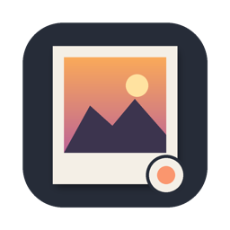
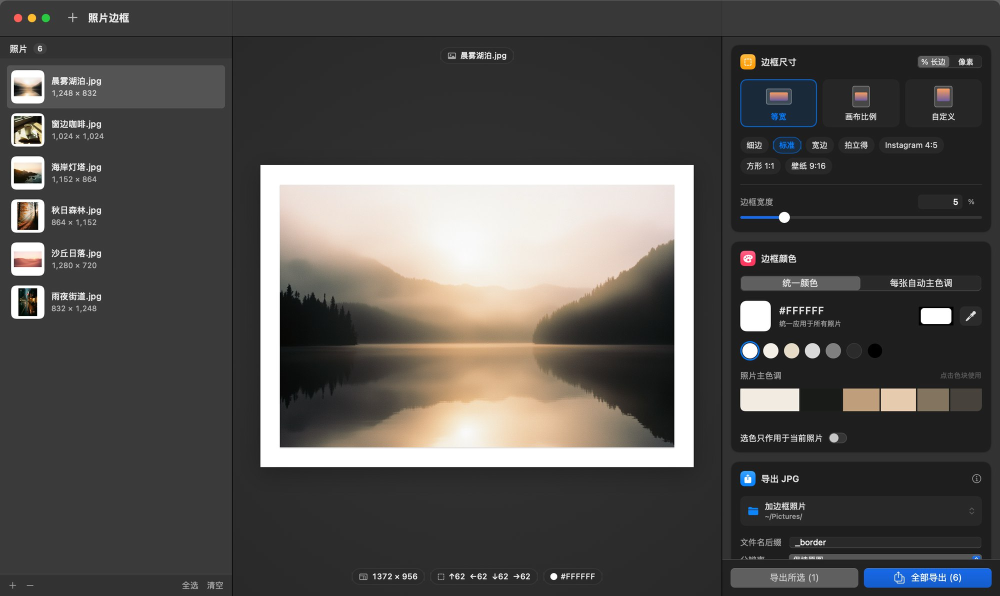
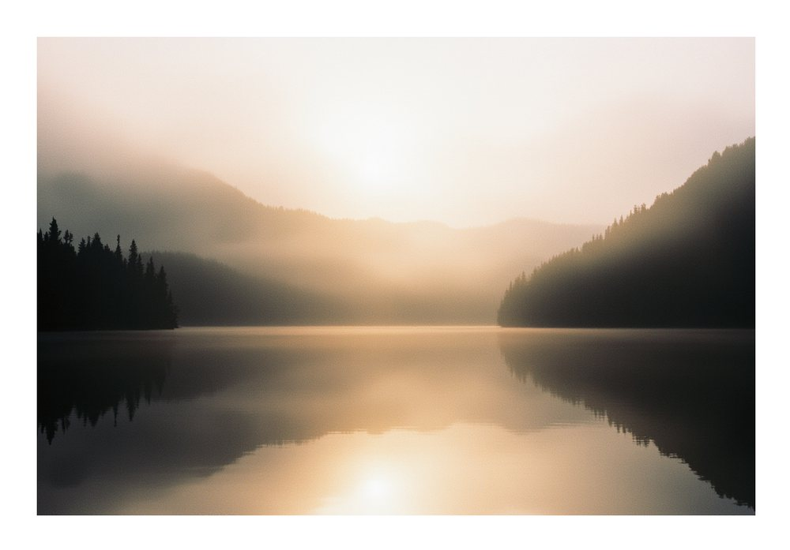
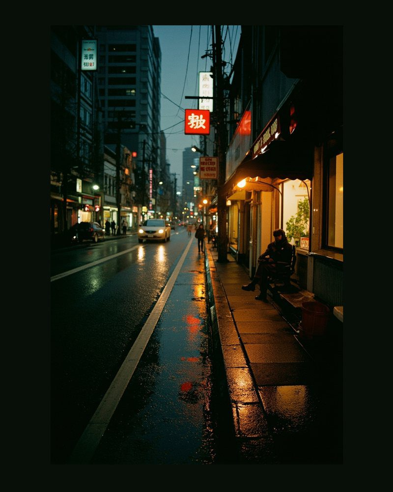
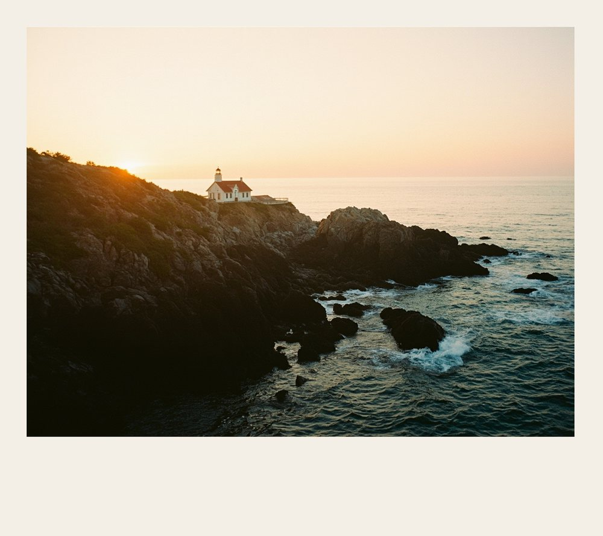
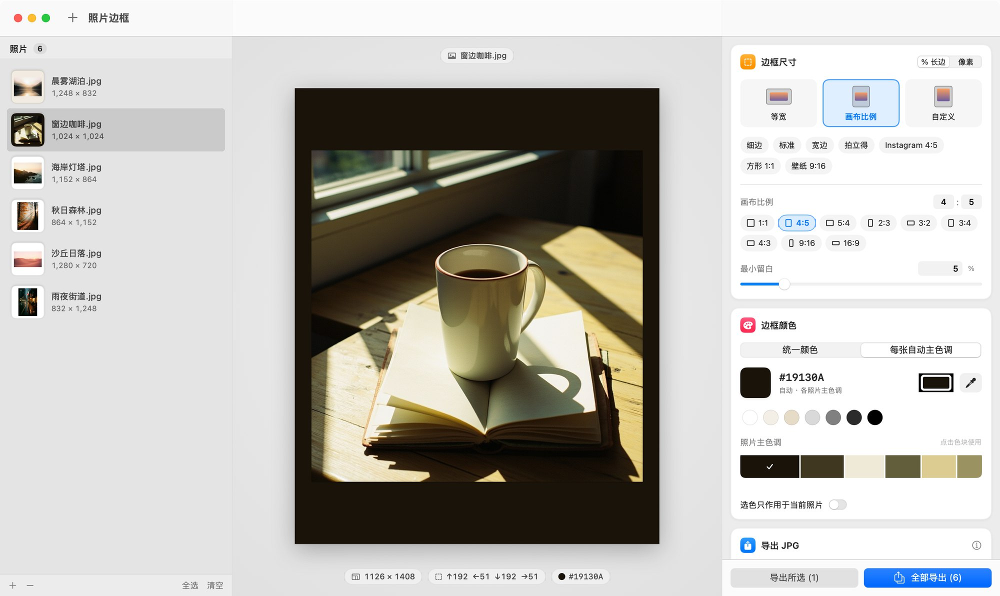

<p align="center">
  
</p>

<h1 align="center">照片边框 PhotoFrame</h1>

<p align="center">
  <b>给照片加一道边框，不损失一个像素。</b><br>
  macOS 原生 App · 批量加边框 · 吸管取色 · 自动主色调 · JPG 无损导出
</p>

<p align="center">
  <a href="https://github.com/jiewent1-cmyk/PhotoFrame/releases/download/v1.3.0/PhotoFrame-1.3.0.dmg"><b>⬇️ 下载 macOS 版（约 2.4 MB）</b></a>
  &nbsp;·&nbsp;
  <a href="https://jiewent1-cmyk.github.io/PhotoFrame/">🌐 产品主页 / 在线试用</a>
</p>

<p align="center">
  
</p>

## 三种边框模式

| 等宽 | 画布比例 | 自定义四边 |
|:---:|:---:|:---:|
|  |  |  |
| 四边一样宽，简洁的画廊感 | 4:5、1:1、9:16 等比例，照片居中 | 上下左右分别设置，比如拍立得风格 |

尺寸可以按**长边百分比**设置，一批横竖、尺寸不同的照片，边框比例也能保持一致；也可以直接按像素设置。

## 边框颜色

- **吸管**：在照片上点一下，取到的颜色直接作为边框色
- **主色调**：自动提取照片的 6 个主色，按占比显示在色带上
- **每张自动主色调**：批量导出时，每张照片自动配上自己的主色调
- **单张单独设色**：可以只给某一张照片换颜色
- 另有常用色板和系统取色器

<p align="center">
  
</p>

## 画质保证

| 原图 | 处理方式 | 结果 |
|---|---|---|
| **JPG** | 在 DCT 域直接拼接边框，复用原图压缩后的数据 | 照片像素与原图**逐位一致**，完全不重新压缩 |
| HEIC / PNG / TIFF / RAW | 自研高精度编码器：Q100、4:4:4、无色度抽样 | PSNR 57.3 dB，高于 libjpeg Q100（56.7）和 macOS 系统编码器（49.7） |

- **色彩**：沿用原图的色彩空间（sRGB / Adobe RGB / Display P3）和 ICC 配置文件，不做任何色彩转换。
- **元数据**：相机、镜头、曝光、拍摄时间、版权、GPS 等 EXIF 信息全部保留。
- **安全**：自动识别被截断、拷贝中断的损坏照片并跳过，不会导出花屏；永远不会覆盖原图。

## 安装

1. [下载 PhotoFrame-1.3.0.dmg](https://github.com/jiewent1-cmyk/PhotoFrame/releases/download/v1.3.0/PhotoFrame-1.3.0.dmg)，打开后把「照片边框」拖到「Applications（应用程序）」文件夹。
2. 第一次打开时，macOS 可能会提示「无法验证开发者」。这是因为本 App 没有付费的 Apple 开发者签名，并不是病毒。任选一种方法放行：
   - 打开「系统设置 → 隐私与安全性」，滚到页面底部，点「仍要打开」；
   - 或者在「终端」里运行下面这行命令，然后再打开 App：
     ```bash
     xattr -dr com.apple.quarantine "/Applications/照片边框.app"
     ```

系统要求：macOS 13 Ventura 或更新版本，Apple 芯片和 Intel 芯片都支持。所有处理都在本地完成，App 不联网。

---

<sub>页面和说明中的示例照片、背景图由 AI（MiniMax）生成。</sub>
